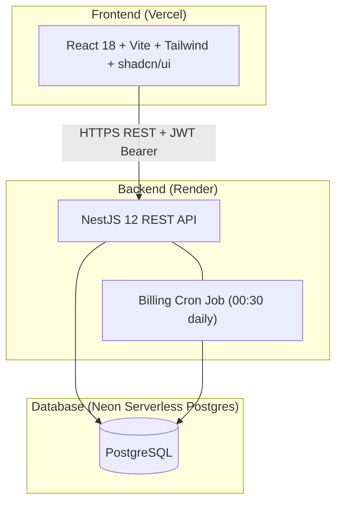

# SubFlow — Subscription Management System

> **By Brightloop Software** — The complete platform for running a subscription business end-to-end.

[](https://opensource.org/licenses/MIT)

## Overview

SubFlow replaces spreadsheets, hand-typed invoices, and manual payment matching with a single, cohesive platform. From product catalog to auto-invoicing to finance reporting — it's all here.

**Roles:** ADMIN · STAFF · CUSTOMER — each with strictly enforced server-side access controls.

## Architecture



## Modules

| Module | Responsibility |
|--------|---------------|
| `auth` | JWT (15 min access + 7d refresh), password reset, bcrypt |
| `users` | User CRUD, staff management (admin only) |
| `customers` | Customer profiles, portal data isolation |
| `products` | Products, variants, soft-delete |
| `plans` | Billing plans, behavior flags |
| `taxes` | GST/tax rules |
| `quotation-templates` | Reusable quote templates |
| `subscriptions` | State machine (DRAFT→PAID), audit log, SUB-numbers |
| `invoices` | Invoice lifecycle, PDF, email, INV-numbers |
| `billing` | Idempotent billing job, SKIP LOCKED, catch-up |
| `discounts` | Discount engine, atomic usage limits |
| `payments` | Payment recording, partial payments, auto-PAID |
| `reports` | SQL aggregate dashboard: MRR, ARR, churn, aging |
| `notifications` | Nodemailer SMTP + PDFKit |
| `audit` | AuditLog viewer |

## Quick Start (Local)

```bash
# 1. Clone
git clone https://github.com/Sharukhh69/SubFlow.git
cd SubFlow

# 2. Backend
cd backend
cp .env.example .env
# ✏️  Paste your Neon DB URLs + other vars into .env
npm install
npx prisma migrate deploy
npm run seed          # Full seed: 500 customers, 10k+ subs, 30k+ invoices
# OR
npm run seed:small    # Quick 200-sub dataset

npm run start:dev     # → http://localhost:3000
# Swagger: http://localhost:3000/api/docs

# 3. Frontend (new terminal)
cd ../frontend
cp .env.example .env  # set VITE_API_URL=http://localhost:3000
npm install
npm run dev           # → http://localhost:5173
```

## Demo Credentials (after `npm run seed`)

| Role | Email | Password |
|------|-------|----------|
| **Admin** | admin@brightloop.com | Admin@12345 |
| **Staff** | staff1@brightloop.com | Staff@12345 |
| **Customer** | customer1@example.com | Customer@12345 |

## Environment Variables

### Backend (`backend/.env`)

| Variable | Description | Required |
|----------|-------------|----------|
| `DATABASE_URL` | Neon pooled connection string (`?pgbouncer=true`) | ✅ |
| `DIRECT_URL` | Neon direct connection string (for migrations) | ✅ |
| `JWT_SECRET` | Access token secret (min 32 chars) | ✅ |
| `JWT_REFRESH_SECRET` | Refresh token secret | ✅ |
| `PORT` | API port (default: 3000) | |
| `NODE_ENV` | `development` or `production` | |
| `FRONTEND_URL` | CORS origin (e.g. http://localhost:5173) | ✅ |
| `ADMIN_EMAIL` | Seed admin email | ✅ |
| `ADMIN_PASSWORD` | Seed admin password | ✅ |
| `SMTP_HOST` | SMTP server host | ✅ |
| `SMTP_PORT` | SMTP port (e.g. 587) | ✅ |
| `SMTP_USER` | SMTP username | ✅ |
| `SMTP_PASS` | SMTP password | ✅ |
| `MAIL_FROM` | From address for emails | ✅ |
| `AUTO_CONFIRM_INVOICES` | `true` to auto-confirm generated invoices | |

### Frontend (`frontend/.env`)

| Variable | Description |
|----------|-------------|
| `VITE_API_URL` | Backend API base URL |

## Testing

```bash
cd backend
npm test              # Jest unit tests
npm run test:e2e      # E2E tests (supertest)
npm run test:cov      # Coverage report
```

## Performance Results

> Run `npm run perf:check` after seeding to generate this table.

| Endpoint | p50 | p95 | p99 |
|----------|-----|-----|-----|
| `GET /api/subscriptions` | — | — | — |
| `GET /api/invoices` | — | — | — |
| `GET /api/reports/dashboard` | — | — | — |

*(Results will be populated in Phase 9 after seeding 10k+ records)*

## Deployment

### Backend → Render
- `render.yaml` is included. Set env vars in Render dashboard.
- Build: `npm install && npx prisma generate && npm run build`
- Start: `npm run start:prod`
- Health: `/api/health`

### Frontend → Vercel
- `vercel.json` includes SPA rewrites.
- Set `VITE_API_URL` to your Render backend URL.

### Database → Neon
- Use the **pooled** connection string for `DATABASE_URL` (app runtime).
- Use the **direct** connection string for `DIRECT_URL` (Prisma migrations).
- Run: `npx prisma migrate deploy && npm run seed`

## Design Decisions

| Decision | Approach |
|----------|----------|
| **Money** | `Decimal(12,2)` in Postgres; `decimal.js` in Node; never JS floats |
| **Idempotency** | `UNIQUE(subscriptionId, billingPeriodStart)` prevents duplicate invoices |
| **State Machine** | Explicit transition map; invalid moves → 409/422 |
| **Overdue** | Derived state (not stored): `CONFIRMED AND dueDate < today AND balance > 0` |
| **Concurrency** | `FOR UPDATE SKIP LOCKED` in billing job |
| **Discount stacking** | Best single discount wins; no stacking |
| **Customer isolation** | Service-layer filter by `customerId`; e2e tests prove isolation |

## Seed Instructions

```bash
npm run seed        # 500 customers, 10k+ subscriptions, 30k+ invoices
npm run seed:small  # 50 customers, 200 subscriptions (fast)
```

## One-Command Docker (Local)

```bash
cp backend/.env.example backend/.env
# Edit backend/.env with your Neon DB URLs
docker-compose up --build
```
