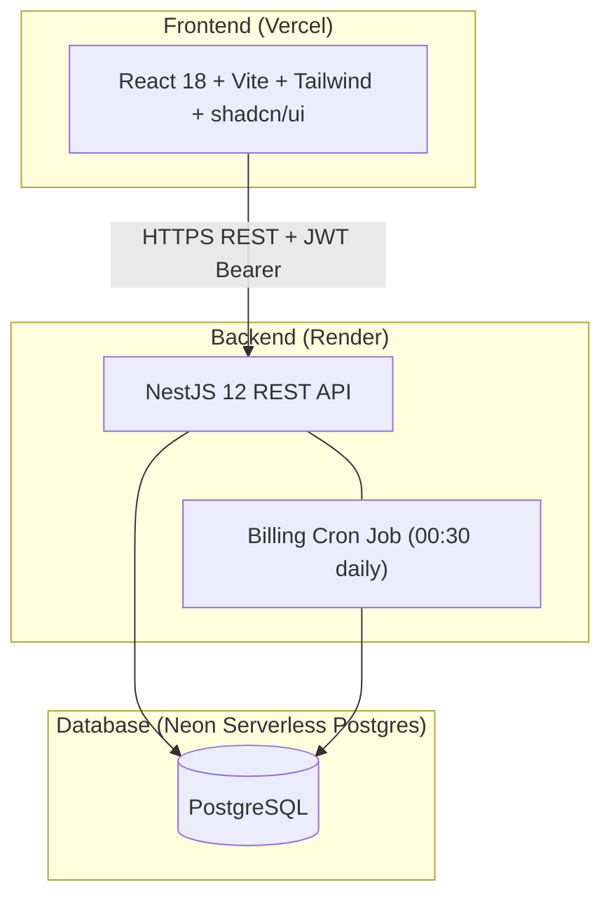
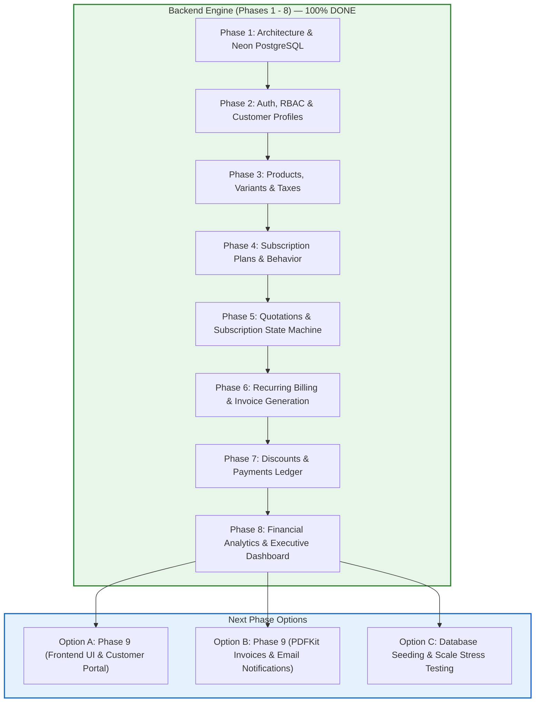

# SubFlow — Subscription Management System

> **By Brightloop Software** — The complete platform for running a subscription business end-to-end.
> 📘 **New Developer or Agent Handover?** Read the [HANDOVER_GUIDE.md](./HANDOVER_GUIDE.md) for 5-minute setup instructions, .env configuration, test credentials, and architecture overview.

[](https://opensource.org/licenses/MIT)

## Overview

SubFlow replaces spreadsheets, hand-typed invoices, and manual payment matching with a single, cohesive platform. From product catalog to auto-invoicing to finance reporting — it's all here.

**Roles:** ADMIN · STAFF · CUSTOMER — each with strictly enforced server-side access controls.

## Architecture



## Modules

| Module | Responsibility |
|--------|---------------|
| `auth` | JWT (15 min access + 7d refresh), password reset, bcrypt |
| `users` | User CRUD, staff management (admin only) |
| `customers` | Customer profiles, portal data isolation |
| `products` | Products, variants, soft-delete |
| `plans` | Billing plans, behavior flags |
| `taxes` | GST/tax rules |
| `quotation-templates` | Reusable quote templates |
| `subscriptions` | State machine (DRAFT→PAID), audit log, SUB-numbers |
| `invoices` | Invoice lifecycle, PDF, email, INV-numbers |
| `billing` | Idempotent billing job, SKIP LOCKED, catch-up |
| `discounts` | Discount engine, atomic usage limits |
| `payments` | Payment recording, partial payments, auto-PAID |
| `reports` | SQL aggregate dashboard: MRR, ARR, churn, aging |
| `notifications` | Nodemailer SMTP + PDFKit |
| `audit` | AuditLog viewer |

## Where We Are in the Lifecycle & Complete Project Recap

### 1. Overall Lifecycle Status: **Backend Core is 100% Complete**

We have completed the **entire backend functional lifecycle** corresponding to every business scene outlined in the Brightloop Software challenge specification (`Subscription_Management_System.md`).



### 2. Up-To-Now Completion Summary (Phases 1 – 8)

| Phase | Scene / Focus | Key Deliverables & Achievements | Test Coverage | Git Commit |
| :---: | :--- | :--- | :---: | :---: |
| **Phase 1** | **Foundations & Schema** | Project setup, NestJS architecture, Prisma ORM, Neon PostgreSQL connectivity, sequence counters. | Compiled | `Initial` |
| **Phase 2** | *"A new customer signs up"* | Strict password policy, JWT access/refresh token rotation, atomic customer signup, staff user management, multi-role RBAC (`ADMIN`, `STAFF`, `CUSTOMER`). | 7 Unit Tests | Completed |
| **Phase 3** | *"Launching a new product"* | Product catalog, dynamic variant attributes (e.g. brand variant `+560`), GST tax engine, soft-delete archiving. | 4 Unit Tests | Completed |
| **Phase 4** | *"Launching a new plan"* | Billing intervals (`DAILY`, `WEEKLY`, `MONTHLY`, `YEARLY`), availability windows, lifecycle flags (`pausable`, `closable`, `autoClose`). | Unit & Smoke | Completed |
| **Phase 5** | *"Turning a quote into a subscription"* | Quotation templates, validity periods, atomic `SUB-000001` sequence generator, 5-stage state machine (`DRAFT` $\to$ `QUOTATION` $\to$ `CONFIRMED` $\to$ `ACTIVE` $\to$ `CLOSED`). | 23 Unit Tests | Completed |
| **Phase 6** | *"Billing day"* | Automated recurring billing engine, `FOR UPDATE SKIP LOCKED` concurrency, idempotent invoice generation (`INV-YYYY-000001`), tax calculation, catch-up billing. | 15 Unit Tests | `f626fd2` |
| **Phase 7** | *"A customer asks for a better price"* & *"The money comes in"* | Discounts engine (fixed/percentage, min purchase, atomic usage counters), payments ledger, partial payments, auto-settlement to `PAID`. | 19 Unit Tests | `96608d9` |
| **Phase 8** | *"The finance lead, at the end of the month"* | Financial analytics engine, MRR/ARR normalization across intervals, accounts receivable aging buckets (`0-30`, `31-60`, `61-90`, `90+`), 60-second in-memory caching, sub-2s query optimizations. | 12 Unit Tests | `ddb2b34` |

- **Total Backend Test Suite**: **80/80 Tests Passing (100% Pass Rate)** across all 8 modules.
- **Repository Branch**: Synchronized on `origin/rohith2024aiml` with a clean working tree.

### 3. What is Our Next Phase?

With all backend business logic and financial analytics fully operational, the remaining aspects of the SubFlow platform fall into the following paths:

#### Option A: **Phase 9 — Full Frontend Client & Customer Portal (Recommended)**
Currently, `frontend/` contains only default Vite boilerplate (`App.tsx`). Building the frontend delivers the visual, end-to-end user experience:
1. **Authentication Flow**: Login, customer self-registration, password reset, and role-based routing.
2. **Executive Dashboard**: Rendering the Phase 8 KPI cards (MRR, ARR, Cash Collected, Overdue Aging breakdown, 6-Month Revenue Trend).
3. **Admin Operations**: Catalog management (products, variants, taxes, plans), quotation builder, and manually triggering the recurring billing run.
4. **Customer Self-Service Portal**: Customers can log in, view their own active subscriptions, inspect invoices, and track payments without contacting staff.

#### Option B: **Phase 9 — Invoice PDF Generation & Email Notifications**
- Implementing the `notifications` module using `PDFKit` to generate downloadable tax invoice PDFs (`/api/invoices/:id/pdf`) and `nodemailer` for SMTP billing dispatch and payment receipts.

#### Option C: **Database Seeding & Large-Scale Performance Verification**
- Executing `npm run seed` to load the database with 500 customers, 10,000+ subscriptions, and 30,000+ invoices to verify query indexing, sub-2s response SLAs, and memory efficiency under heavy load.


## Quick Start (Local)

```bash
# 1. Clone
git clone https://github.com/Sharukhh69/SubFlow.git
cd SubFlow

# 2. Backend
cd backend
cp .env.example .env
# ✏️  Paste your Neon DB URLs + other vars into .env
npm install
npx prisma migrate deploy
npm run seed          # Full seed: 500 customers, 10k+ subs, 30k+ invoices
# OR
npm run seed:small    # Quick 200-sub dataset

npm run start:dev     # → http://localhost:3000
# Swagger: http://localhost:3000/api/docs

# 3. Frontend (new terminal)
cd ../frontend
cp .env.example .env  # set VITE_API_URL=http://localhost:3000
npm install
npm run dev           # → http://localhost:5173
```

## Demo Credentials (after `npm run seed`)

| Role | Email | Password |
|------|-------|----------|
| **Admin** | admin@brightloop.com | Admin@12345 |
| **Staff** | staff1@brightloop.com | Staff@12345 |
| **Customer** | customer1@example.com | Customer@12345 |

## Environment Variables

### Backend (`backend/.env`)

| Variable | Description | Required |
|----------|-------------|----------|
| `DATABASE_URL` | Neon pooled connection string (`?pgbouncer=true`) | ✅ |
| `DIRECT_URL` | Neon direct connection string (for migrations) | ✅ |
| `JWT_SECRET` | Access token secret (min 32 chars) | ✅ |
| `JWT_REFRESH_SECRET` | Refresh token secret | ✅ |
| `PORT` | API port (default: 3000) | |
| `NODE_ENV` | `development` or `production` | |
| `FRONTEND_URL` | CORS origin (e.g. http://localhost:5173) | ✅ |
| `ADMIN_EMAIL` | Seed admin email | ✅ |
| `ADMIN_PASSWORD` | Seed admin password | ✅ |
| `SMTP_HOST` | SMTP server host | ✅ |
| `SMTP_PORT` | SMTP port (e.g. 587) | ✅ |
| `SMTP_USER` | SMTP username | ✅ |
| `SMTP_PASS` | SMTP password | ✅ |
| `MAIL_FROM` | From address for emails | ✅ |
| `AUTO_CONFIRM_INVOICES` | `true` to auto-confirm generated invoices | |

### Frontend (`frontend/.env`)

| Variable | Description |
|----------|-------------|
| `VITE_API_URL` | Backend API base URL |

## Testing

```bash
cd backend
npm test              # Jest unit tests
npm run test:e2e      # E2E tests (supertest)
npm run test:cov      # Coverage report
```

## Performance Results

> Run `npm run perf:check` after seeding to generate this table.

| Endpoint | p50 | p95 | p99 |
|----------|-----|-----|-----|
| `GET /api/subscriptions` | — | — | — |
| `GET /api/invoices` | — | — | — |
| `GET /api/reports/dashboard` | — | — | — |

*(Results will be populated in Phase 9 after seeding 10k+ records)*

## Deployment

### Backend → Render
- `render.yaml` is included. Set env vars in Render dashboard.
- Build: `npm install && npx prisma generate && npm run build`
- Start: `npm run start:prod`
- Health: `/api/health`

### Frontend → Vercel
- `vercel.json` includes SPA rewrites.
- Set `VITE_API_URL` to your Render backend URL.

### Database → Neon
- Use the **pooled** connection string for `DATABASE_URL` (app runtime).
- Use the **direct** connection string for `DIRECT_URL` (Prisma migrations).
- Run: `npx prisma migrate deploy && npm run seed`

## Design Decisions

| Decision | Approach |
|----------|----------|
| **Money** | `Decimal(12,2)` in Postgres; `decimal.js` in Node; never JS floats |
| **Idempotency** | `UNIQUE(subscriptionId, billingPeriodStart)` prevents duplicate invoices |
| **State Machine** | Explicit transition map; invalid moves → 409/422 |
| **Overdue** | Derived state (not stored): `CONFIRMED AND dueDate < today AND balance > 0` |
| **Concurrency** | `FOR UPDATE SKIP LOCKED` in billing job |
| **Discount stacking** | Best single discount wins; no stacking |
| **Customer isolation** | Service-layer filter by `customerId`; e2e tests prove isolation |

## Seed Instructions

```bash
npm run seed        # 500 customers, 10k+ subscriptions, 30k+ invoices
npm run seed:small  # 50 customers, 200 subscriptions (fast)
```

## One-Command Docker (Local)

```bash
cp backend/.env.example backend/.env
# Edit backend/.env with your Neon DB URLs
docker-compose up --build
```
